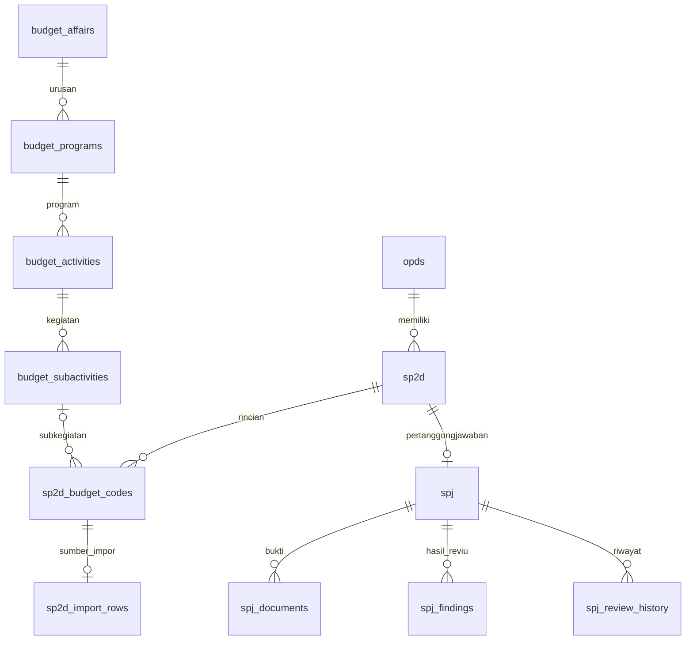

# Normalisasi relasi belanja — 11 Oktober 2026

> Catatan tahap awal. Status terbaru setelah peninjauan seluruh database ada di [Normalisasi menyeluruh](NORMALISASI-MENYELURUH.md); sejumlah kolom kompatibilitas yang disebut di bawah kini sudah dihapus.

## Perubahan yang diterapkan

Struktur baru memisahkan hierarki belanja dari transaksi. Satu baris rincian SP2D menyimpan satu referensi subkegiatan; kegiatan, program, dan urusannya diperoleh melalui induk masing-masing.

- `budget_affairs`: nama urusan unik.
- `budget_programs`: nama program unik di dalam satu urusan.
- `budget_activities`: nama kegiatan unik di dalam satu program.
- `budget_subactivities`: nama subkegiatan unik di dalam satu kegiatan.
- `sp2d_budget_codes.budget_subactivity_id`: foreign key opsional untuk kompatibilitas data lama. Tidak ada kolom induk lain yang diduplikasi pada rincian.
- Semua relasi master menggunakan `RESTRICT`: induk yang masih digunakan tidak boleh dihapus.
- Rincian rekening tetap berupa baris transaksi dengan primary key sendiri. Tidak diberi UNIQUE pada `(sp2d_id, kode_belanja)` karena kode berulang merupakan kebutuhan bisnis.
- `sp2d_import_rows`: maksimal satu rekaman asal untuk setiap rincian impor. Headers dan values merupakan array berurutan agar dua kolom `URAIAN` tidak saling menimpa. Ini arsip sumber impor, bukan master atau tabel transaksi BKU.

Template saat ini hanya menyediakan **nama**, bukan kode resmi urusan/program/kegiatan/subkegiatan. Identitas master menggunakan nama dalam lingkup induknya dengan collation database. Kode resmi tidak dibuat-buat. Jika tersedia kode resmi atau versi nomenklatur tahunan, kunci bisnis perlu diperluas berdasarkan sumber otoritatif tersebut. Perubahan nama akan menghasilkan entri master baru, bukan mengubah riwayat transaksi lama.

## Perilaku impor

1. File divalidasi penuh sebelum transaksi penyimpanan dimulai.
2. Kolom `NAMA_URUSAN`, `NAMA_PROGRAM`, `NAMA_KEGIATAN`, dan `NAMA_SUB_KEGIATAN` dibaca dari template.
3. Jika sebagian hierarki terisi, keempat tingkat wajib lengkap. Baris tidak lengkap menolak seluruh impor dengan nomor baris.
4. File lama tanpa hierarki tetap diterima; hasil impor menyebut jumlah rincian yang belum mempunyai hierarki. Tidak ada tebakan dari kode rekening.
5. Master dicari/dibuat menurut induk, kemudian referensi subkegiatan disimpan pada rincian.
6. Seluruh nilai kolom pada baris yang diimpor disimpan sebagai arsip sumber, termasuk informasi BKU dan dua uraian. Arsip bukan salinan file biner: format sel, formula asli, serta worksheet lain tidak diarsipkan. Alur impor membaca worksheet pertama sebagaimana sebelumnya.
7. SP2D dengan nomor yang sudah ada tetap dilewati; impor ulang tidak memperkaya atau menimpa data lama secara otomatis.
8. Halaman detail SP2D menampilkan hierarki tiap rincian, atau keterangan belum tersedia.

## Batas normalisasi yang dipertahankan

Perubahan ini menormalisasi **hierarki belanja**, bukan menyatakan seluruh schema sudah 3NF murni. Beberapa kolom lama tetap dipertahankan demi kompatibilitas alur laporan, reviu, dan otorisasi:

| Data | Alasan dipertahankan / langkah lanjutan |
|---|---|
| `sp2d.tahun`, `triwulan`, `jumlah_total` | Atribut turunan/ringkasan; impor mengisi dari tanggal dan penjumlahan rincian. Formulir manual masih perlu audit konsistensi sebelum mengganti kolom dengan nilai turunan. |
| `spj.opd_id` | Redundan terhadap induk SP2D; model memeriksa kesamaan. Penghapusan memerlukan perubahan seluruh query otorisasi/laporan; belum dihapus pada migrasi ini. |
| `sp2d_budget_codes.kode_belanja`, `uraian` | Snapshot rekening transaksi. Satu kode tidak diasumsikan selalu memiliki satu uraian historis. Master rekening resmi berversi memerlukan sumber yang disepakati. |
| `users.role` dan tabel pivot Spatie | Kompatibilitas kode lama; konsolidasi satu sumber role perlu audit akses tersendiri. |
| Nama pengguna pada audit, nama OPD pada ekspor, JSON riwayat reviu | Snapshot historis yang sengaja dipertahankan. |
| `review_guides.kode_rekening` | Lookup panduan berdasarkan kode; bukan foreign key ke baris transaksi. |

Relasi polimorfik Spatie dan audit tidak diubah menjadi foreign key ke satu tabel, karena memang dapat merujuk tipe objek berbeda.

## Migrasi dan perlindungan data

Migrasi: `2026_10_11_100000_normalize_sp2d_budget_hierarchy.php`.

- Bersifat aditif: menambah lima tabel dan satu foreign key nullable; tidak menghapus/menggabungkan rincian lama.
- Data lama tanpa sumber hierarki tetap NULL. Informasi yang sebelumnya tidak tersimpan tidak dapat dipulihkan hanya dengan migrasi.
- Sudah diterapkan pada database lokal setelah backup. Sebelum/sesudah: 55 OPD, 5 user, 0 SP2D, 0 rincian, 0 SPJ. Data SP2D kosong akibat penghapusan yang diminta sebelumnya.
- Backup lokal sebelum migrasi: `75f6b5b6-81bc-48dc-a209-a99b10118bc5`, mengikuti retensi fitur backup 24 jam.
- Server produksi lain belum disentuh. Untuk penerapan: buat dan verifikasi backup, hentikan sementara penulisan/impor selama deployment, jalankan migrasi, restart worker, lalu cek hasil impor contoh pada lingkungan uji terlebih dahulu.
- Rollback menghapus master hierarki dan arsip sumber baru. Jangan rollback setelah impor baru tanpa backup dan rencana pemulihan.

## Verifikasi

69 tes lulus, 1 dilewati, 313 assertions. Termasuk impor XLSX nyata dengan header URAIAN ganda, deduplikasi master berdasarkan induk, rincian kode berulang, penolakan hierarki parsial, kompatibilitas file lama, perlindungan foreign key, pelestarian data saat migrasi, dan regresi aplikasi.
