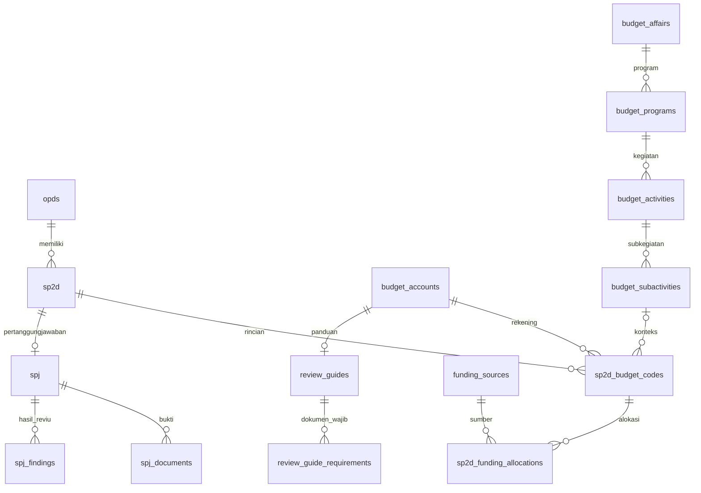

# Normalisasi seluruh schema — 12 Oktober 2026

Database lokal kini memiliki **36 tabel**. Peninjauan meliputi seluruh tabel; perubahan fisik diterapkan pada relasi operasional yang menyimpan informasi berulang. Snapshot historis dan payload infrastruktur dipertahankan sesuai tujuannya, bukan diklaim sebagai seluruhnya 3NF murni.

## Hasil perubahan

| Sebelumnya | Sekarang |
|---|---|
| `spj.opd_id` mengulang OPD pada SP2D | Kolom dihapus. OPD ditelusuri melalui `spj.sp2d_id → sp2d.opd_id`. Dashboard, laporan, dan pembatasan akses mengikuti relasi ini. |
| `sp2d.tahun` dan `triwulan` bisa bertentangan dengan tanggal | Kolom dihapus. Nilai dihitung dari tanggal; formulir tidak lagi meminta periode terpisah. Filter menggunakan tanggal. |
| `users.role` berdampingan dengan pivot role | Kolom lama dihapus. Role dan hak akses hanya memakai tabel Spatie. Migrasi berhenti jika pengguna belum punya role, tanpa memberi akses secara otomatis. |
| Kode rekening berulang pada rincian | `budget_accounts.code` menjadi master unik; rincian menyimpan `budget_account_id`. ID rincian, uraian, dan nominal transaksi tetap utuh. |
| Panduan tidak terhubung ke master rekening | `review_guides.kode_rekening` menjadi foreign key ke natural key `budget_accounts.code`. |
| Daftar dokumen wajib berupa JSON/teks | Setiap item dipindahkan ke `review_guide_requirements`, lengkap dengan urutannya. JSON lama, JSON berlapis, dan daftar teks yang didukung dibaca saat migrasi. |

Hierarki urusan → program → kegiatan → subkegiatan dan alokasi sumber dana dari perubahan sebelumnya tetap berlaku.

## Hasil peninjauan seluruh tabel

| Kelompok | Tabel | Keputusan |
|---|---|---|
| Identitas | `opds`, `users` | Master identitas dengan kunci unik; pengguna merujuk OPD/Irban, tidak menyimpan ulang nama induk. Role lama dihapus. |
| Master anggaran | `budget_affairs`, `budget_programs`, `budget_activities`, `budget_subactivities`, `budget_accounts`, `funding_sources` | Entitas terpisah, identitas unik dalam lingkup induk yang sesuai. |
| Transaksi realisasi | `sp2d`, `sp2d_budget_codes`, `sp2d_funding_allocations` | Header, baris transaksi, dan pembagian sumber dana terpisah. Periode diturunkan dari tanggal. |
| Pertanggungjawaban | `spj`, `spj_documents`, `spj_findings` | Header, bukti, dan hasil reviu terpisah; OPD SPJ mengikuti SP2D. |
| Panduan dan jadwal | `review_guides`, `review_guide_requirements`, `schedules` | Daftar dokumen wajib menjadi tabel anak; jadwal merupakan entitas mandiri. |
| Penugasan | `auditor_opd_assignments` | Relasi pengguna–OPD dengan pasangan unik. |
| Hak akses | `roles`, `permissions`, `model_has_roles`, `model_has_permissions`, `role_has_permissions` | Master dan tabel penghubung menjadi satu-satunya sumber hak akses. Model polimorfik mengikuti kontrak Spatie. |
| Riwayat dan arsip | `activity_logs`, `spj_review_history`, `sp2d_import_rows`, `spj_exports` | Snapshot/payload sengaja dipertahankan agar data historis tidak berubah ketika master berubah. |
| Infrastruktur | `cache`, `cache_locks`, `jobs`, `job_batches`, `failed_jobs`, `sessions`, `password_reset_tokens`, `migrations`, `pending_file_deletions` | Struktur mengikuti kontrak framework/antrean. Payload operasional tidak dipecah menjadi tabel domain. |

## Informasi yang tetap disimpan dan alasannya

- **Nominal header SP2D (`jumlah_total`) dan SPJ (`jumlah`)** tetap dipertahankan sebagai nominal dokumen. Ini pengecualian terhadap penghilangan seluruh nilai ringkasan; jumlah rincian dapat dibandingkan untuk rekonsiliasi, bukan mengubah nilai dokumen lama secara otomatis. Impor saat ini memang menghitung total SP2D dari rincian; formulir manual masih menyimpan nominal yang dimasukkan pengguna. Karena itu keseluruhan schema tidak diklaim sebagai 3NF murni tanpa pengecualian.
- **Uraian tiap rincian** tetap atribut transaksi. Kode sama dapat memiliki uraian berbeda; migrasi tidak memilih salah satunya sebagai nama resmi dan tidak menggabungkan baris.
- **Nama belanja pada panduan** adalah judul panduan yang unik per rekening, bukan sumber penamaan ulang seluruh transaksi.
- **Nama pengguna pada audit, nama OPD pada ekspor, JSON snapshot reviu, dan nilai sumber impor** adalah catatan pada saat kejadian. Tidak diganti dengan pembacaan master terkini.
- Master rekening baru menyimpan kode yang tersedia, bukan mengaku sebagai katalog nomenklatur resmi berversi tahunan. Untuk itu tetap dibutuhkan dataset resmi beserta aturan versinya.

## Kompatibilitas aplikasi

Accessor menyediakan `tahun`, `triwulan`, `opd_id` SPJ, `kode_belanja`, dan `required_documents` untuk tampilan lama, tetapi atribut tersebut tidak lagi disimpan sebagai kolom lama. Query SQL langsung wajib memakai schema baru. Kode dan migrasi harus dirilis bersama; hentikan sementara penulisan selama deployment dan restart worker setelah migrasi.

Normalisasi tidak mengubah keputusan reviu, sumber dana, nominal transaksi, ID rincian, atau pasangan hak akses. Nomor SP2D yang diimpor ulang tetap dilewati sesuai alur sebelumnya.

## Migrasi dan verifikasi

Migrasi baru:

- `2026_10_12_100000_normalize_core_relations.php`
- `2026_10_12_110000_normalize_review_requirements.php`

Migrasi melakukan pemeriksaan sebelum menghapus kolom: OPD SPJ harus sama dengan SP2D, tahun/triwulan harus sesuai tanggal, dan setiap pengguna harus mempunyai role Spatie. Ketidaksesuaian menghentikan migrasi agar tidak diselesaikan dengan asumsi.

**Lokal:** kedua migrasi berhasil. Sebanyak 55 OPD dan 5 pengguna tetap utuh; sidik data OPD, pengguna (di luar kolom role yang sengaja dihapus), dan seluruh pivot hak akses cocok sebelum/sesudah. Data SP2D/SPJ lokal tetap kosong setelah penghapusan yang diminta sebelumnya.

**Backup:** `d05680f5-6b87-4140-9c3d-9f60d9518507`, dibuat sebelum migrasi, mengikuti retensi fitur backup 24 jam.

**Tes:** 80 lulus, 1 tes skala besar dilewati, 397 assertions. Termasuk migrasi naik/turun dengan data berisi, pelestarian bukti SPJ dan rincian berulang, daftar dokumen berurutan, akses antar-OPD, impor Excel, analisis belanja, dan sumber dana. `app:preflight` lulus. Pengujian otomatis menggunakan SQLite; penerapan schema lokal berhasil pada MySQL. Belum ada uji migrasi terhadap salinan penuh database produksi lain.

**Produksi lain belum disentuh.** Sebelum deployment, uji dengan salinan data produksinya dan verifikasi pemulihan backup. DDL MySQL tidak atomik: kegagalan di tengah migrasi perlu pemeriksaan tahap yang selesai atau pemulihan backup, bukan menjalankan ulang secara membabi buta. Rollback mengembalikan periode dan OPD dari relasi, serta role lama dari role Spatie utama; nilai lama yang sebelumnya bertentangan tidak direkonstruksi. Backup tetap rujukan pemulihan identik.
