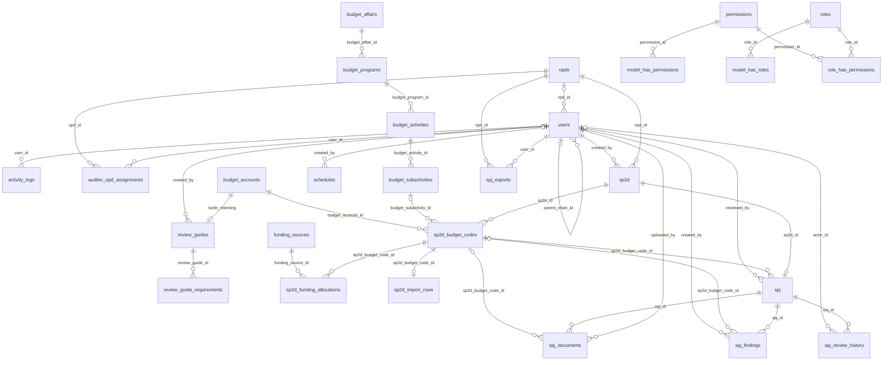

# Schema database aplikasi SPJ OPD

Metadata database lokal `spj_opd`, 12 Oktober 2026. Terdapat 36 tabel setelah normalisasi relasi inti dan panduan reviu.

Lihat [keputusan peninjauan seluruh tabel](NORMALISASI-MENYELURUH.md).

## Relasi fisik

`o|` berarti induk opsional, `||` wajib; `o{` nol atau banyak anak. Diagram hanya menampilkan foreign key fisik.

## Kamus tabel

### activity_logs

| Kolom | Tipe aktual | Boleh NULL |
|---|---|---|
| `id` | `bigint unsigned` | Tidak |
| `user_id` | `bigint unsigned` | Ya |
| `user_name` | `varchar(255)` | Ya |
| `user_email` | `varchar(255)` | Ya |
| `user_role` | `varchar(255)` | Ya |
| `action` | `varchar(50)` | Tidak |
| `module` | `varchar(50)` | Tidak |
| `description` | `text` | Ya |
| `subject_type` | `varchar(255)` | Ya |
| `subject_id` | `varchar(100)` | Ya |
| `ip_address` | `varchar(45)` | Ya |
| `user_agent` | `varchar(255)` | Ya |
| `created_at` | `timestamp` | Ya |
| `updated_at` | `timestamp` | Ya |

Indeks:

- `activity_logs_created_at_index`: `created_at`
- `activity_logs_module_action_index`: `module`, `action`
- `activity_logs_user_id_foreign`: `user_id`
- `primary`: `id` — unik

Relasi:

- `user_id` → `users(id)`; ON DELETE **SET NULL**.

### auditor_opd_assignments

| Kolom | Tipe aktual | Boleh NULL |
|---|---|---|
| `id` | `bigint unsigned` | Tidak |
| `user_id` | `bigint unsigned` | Tidak |
| `opd_id` | `bigint unsigned` | Tidak |
| `created_at` | `timestamp` | Ya |
| `updated_at` | `timestamp` | Ya |

Indeks:

- `auditor_opd_assignments_opd_id_foreign`: `opd_id`
- `auditor_opd_assignments_user_id_opd_id_unique`: `user_id`, `opd_id` — unik
- `primary`: `id` — unik

Relasi:

- `opd_id` → `opds(id)`; ON DELETE **CASCADE**.
- `user_id` → `users(id)`; ON DELETE **CASCADE**.

### budget_accounts

| Kolom | Tipe aktual | Boleh NULL |
|---|---|---|
| `id` | `bigint unsigned` | Tidak |
| `code` | `varchar(50)` | Tidak |
| `created_at` | `timestamp` | Ya |
| `updated_at` | `timestamp` | Ya |

Indeks:

- `budget_accounts_code_unique`: `code` — unik
- `primary`: `id` — unik

### budget_activities

| Kolom | Tipe aktual | Boleh NULL |
|---|---|---|
| `id` | `bigint unsigned` | Tidak |
| `budget_program_id` | `bigint unsigned` | Tidak |
| `name` | `varchar(255)` | Tidak |
| `created_at` | `timestamp` | Ya |
| `updated_at` | `timestamp` | Ya |

Indeks:

- `budget_activities_budget_program_id_name_unique`: `budget_program_id`, `name` — unik
- `primary`: `id` — unik

Relasi:

- `budget_program_id` → `budget_programs(id)`; ON DELETE **RESTRICT**.

### budget_affairs

| Kolom | Tipe aktual | Boleh NULL |
|---|---|---|
| `id` | `bigint unsigned` | Tidak |
| `name` | `varchar(255)` | Tidak |
| `created_at` | `timestamp` | Ya |
| `updated_at` | `timestamp` | Ya |

Indeks:

- `budget_affairs_name_unique`: `name` — unik
- `primary`: `id` — unik

### budget_programs

| Kolom | Tipe aktual | Boleh NULL |
|---|---|---|
| `id` | `bigint unsigned` | Tidak |
| `budget_affair_id` | `bigint unsigned` | Tidak |
| `name` | `varchar(255)` | Tidak |
| `created_at` | `timestamp` | Ya |
| `updated_at` | `timestamp` | Ya |

Indeks:

- `budget_programs_budget_affair_id_name_unique`: `budget_affair_id`, `name` — unik
- `primary`: `id` — unik

Relasi:

- `budget_affair_id` → `budget_affairs(id)`; ON DELETE **RESTRICT**.

### budget_subactivities

| Kolom | Tipe aktual | Boleh NULL |
|---|---|---|
| `id` | `bigint unsigned` | Tidak |
| `budget_activity_id` | `bigint unsigned` | Tidak |
| `name` | `varchar(255)` | Tidak |
| `created_at` | `timestamp` | Ya |
| `updated_at` | `timestamp` | Ya |

Indeks:

- `budget_subactivities_budget_activity_id_name_unique`: `budget_activity_id`, `name` — unik
- `primary`: `id` — unik

Relasi:

- `budget_activity_id` → `budget_activities(id)`; ON DELETE **RESTRICT**.

### cache

| Kolom | Tipe aktual | Boleh NULL |
|---|---|---|
| `key` | `varchar(255)` | Tidak |
| `value` | `mediumtext` | Tidak |
| `expiration` | `bigint` | Tidak |

Indeks:

- `cache_expiration_index`: `expiration`
- `primary`: `key` — unik

### cache_locks

| Kolom | Tipe aktual | Boleh NULL |
|---|---|---|
| `key` | `varchar(255)` | Tidak |
| `owner` | `varchar(255)` | Tidak |
| `expiration` | `bigint` | Tidak |

Indeks:

- `cache_locks_expiration_index`: `expiration`
- `primary`: `key` — unik

### failed_jobs

| Kolom | Tipe aktual | Boleh NULL |
|---|---|---|
| `id` | `bigint unsigned` | Tidak |
| `uuid` | `varchar(255)` | Tidak |
| `connection` | `text` | Tidak |
| `queue` | `text` | Tidak |
| `payload` | `longtext` | Tidak |
| `exception` | `longtext` | Tidak |
| `failed_at` | `timestamp` | Tidak |

Indeks:

- `failed_jobs_uuid_unique`: `uuid` — unik
- `primary`: `id` — unik

### funding_sources

| Kolom | Tipe aktual | Boleh NULL |
|---|---|---|
| `id` | `bigint unsigned` | Tidak |
| `name` | `varchar(255)` | Tidak |
| `created_at` | `timestamp` | Ya |
| `updated_at` | `timestamp` | Ya |

Indeks:

- `funding_sources_name_unique`: `name` — unik
- `primary`: `id` — unik

### job_batches

| Kolom | Tipe aktual | Boleh NULL |
|---|---|---|
| `id` | `varchar(255)` | Tidak |
| `name` | `varchar(255)` | Tidak |
| `total_jobs` | `int` | Tidak |
| `pending_jobs` | `int` | Tidak |
| `failed_jobs` | `int` | Tidak |
| `failed_job_ids` | `longtext` | Tidak |
| `options` | `mediumtext` | Ya |
| `cancelled_at` | `int` | Ya |
| `created_at` | `int` | Tidak |
| `finished_at` | `int` | Ya |

Indeks:

- `primary`: `id` — unik

### jobs

| Kolom | Tipe aktual | Boleh NULL |
|---|---|---|
| `id` | `bigint unsigned` | Tidak |
| `queue` | `varchar(255)` | Tidak |
| `payload` | `longtext` | Tidak |
| `attempts` | `tinyint unsigned` | Tidak |
| `reserved_at` | `int unsigned` | Ya |
| `available_at` | `int unsigned` | Tidak |
| `created_at` | `int unsigned` | Tidak |

Indeks:

- `jobs_queue_index`: `queue`
- `primary`: `id` — unik

### migrations

| Kolom | Tipe aktual | Boleh NULL |
|---|---|---|
| `id` | `int unsigned` | Tidak |
| `migration` | `varchar(255)` | Tidak |
| `batch` | `int` | Tidak |

Indeks:

- `primary`: `id` — unik

### model_has_permissions

| Kolom | Tipe aktual | Boleh NULL |
|---|---|---|
| `permission_id` | `bigint unsigned` | Tidak |
| `model_type` | `varchar(255)` | Tidak |
| `model_id` | `bigint unsigned` | Tidak |

Indeks:

- `model_has_permissions_model_id_model_type_index`: `model_id`, `model_type`
- `primary`: `permission_id`, `model_id`, `model_type` — unik

Relasi:

- `permission_id` → `permissions(id)`; ON DELETE **CASCADE**.

### model_has_roles

| Kolom | Tipe aktual | Boleh NULL |
|---|---|---|
| `role_id` | `bigint unsigned` | Tidak |
| `model_type` | `varchar(255)` | Tidak |
| `model_id` | `bigint unsigned` | Tidak |

Indeks:

- `model_has_roles_model_id_model_type_index`: `model_id`, `model_type`
- `primary`: `role_id`, `model_id`, `model_type` — unik

Relasi:

- `role_id` → `roles(id)`; ON DELETE **CASCADE**.

### opds

| Kolom | Tipe aktual | Boleh NULL |
|---|---|---|
| `id` | `bigint unsigned` | Tidak |
| `nama_opd` | `varchar(255)` | Tidak |
| `kode_unit` | `varchar(50)` | Ya |
| `singkatan` | `varchar(50)` | Ya |
| `created_at` | `timestamp` | Ya |
| `updated_at` | `timestamp` | Ya |

Indeks:

- `opds_kode_unit_unique`: `kode_unit` — unik
- `primary`: `id` — unik

### password_reset_tokens

| Kolom | Tipe aktual | Boleh NULL |
|---|---|---|
| `email` | `varchar(255)` | Tidak |
| `token` | `varchar(255)` | Tidak |
| `created_at` | `timestamp` | Ya |

Indeks:

- `primary`: `email` — unik

### pending_file_deletions

| Kolom | Tipe aktual | Boleh NULL |
|---|---|---|
| `id` | `bigint unsigned` | Tidak |
| `disk` | `varchar(20)` | Tidak |
| `path` | `text` | Tidak |
| `created_at` | `timestamp` | Ya |
| `updated_at` | `timestamp` | Ya |

Indeks:

- `primary`: `id` — unik

### permissions

| Kolom | Tipe aktual | Boleh NULL |
|---|---|---|
| `id` | `bigint unsigned` | Tidak |
| `name` | `varchar(255)` | Tidak |
| `guard_name` | `varchar(255)` | Tidak |
| `created_at` | `timestamp` | Ya |
| `updated_at` | `timestamp` | Ya |

Indeks:

- `permissions_name_guard_name_unique`: `name`, `guard_name` — unik
- `primary`: `id` — unik

### review_guide_requirements

| Kolom | Tipe aktual | Boleh NULL |
|---|---|---|
| `id` | `bigint unsigned` | Tidak |
| `review_guide_id` | `bigint unsigned` | Tidak |
| `position` | `int unsigned` | Tidak |
| `name` | `text` | Tidak |

Indeks:

- `primary`: `id` — unik
- `review_guide_requirements_review_guide_id_position_unique`: `review_guide_id`, `position` — unik

Relasi:

- `review_guide_id` → `review_guides(id)`; ON DELETE **CASCADE**.

### review_guides

| Kolom | Tipe aktual | Boleh NULL |
|---|---|---|
| `id` | `bigint unsigned` | Tidak |
| `kode_rekening` | `varchar(50)` | Tidak |
| `nama_belanja` | `varchar(255)` | Tidak |
| `notes` | `text` | Ya |
| `is_active` | `tinyint(1)` | Tidak |
| `created_by` | `bigint unsigned` | Ya |
| `created_at` | `timestamp` | Ya |
| `updated_at` | `timestamp` | Ya |

Indeks:

- `primary`: `id` — unik
- `review_guides_created_by_foreign`: `created_by`
- `review_guides_kode_rekening_unique`: `kode_rekening` — unik

Relasi:

- `created_by` → `users(id)`; ON DELETE **SET NULL**.
- `kode_rekening` → `budget_accounts(code)`; ON DELETE **RESTRICT**.

### role_has_permissions

| Kolom | Tipe aktual | Boleh NULL |
|---|---|---|
| `permission_id` | `bigint unsigned` | Tidak |
| `role_id` | `bigint unsigned` | Tidak |

Indeks:

- `primary`: `permission_id`, `role_id` — unik
- `role_has_permissions_role_id_foreign`: `role_id`

Relasi:

- `permission_id` → `permissions(id)`; ON DELETE **CASCADE**.
- `role_id` → `roles(id)`; ON DELETE **CASCADE**.

### roles

| Kolom | Tipe aktual | Boleh NULL |
|---|---|---|
| `id` | `bigint unsigned` | Tidak |
| `name` | `varchar(255)` | Tidak |
| `guard_name` | `varchar(255)` | Tidak |
| `created_at` | `timestamp` | Ya |
| `updated_at` | `timestamp` | Ya |

Indeks:

- `primary`: `id` — unik
- `roles_name_guard_name_unique`: `name`, `guard_name` — unik

### schedules

| Kolom | Tipe aktual | Boleh NULL |
|---|---|---|
| `id` | `bigint unsigned` | Tidak |
| `type` | `enum('upload_period','review_period')` | Tidak |
| `start_date` | `date` | Tidak |
| `end_date` | `date` | Tidak |
| `description` | `text` | Ya |
| `is_active` | `tinyint(1)` | Tidak |
| `created_by` | `bigint unsigned` | Ya |
| `created_at` | `timestamp` | Ya |
| `updated_at` | `timestamp` | Ya |

Indeks:

- `primary`: `id` — unik
- `schedules_created_by_foreign`: `created_by`

Relasi:

- `created_by` → `users(id)`; ON DELETE **SET NULL**.

### sessions

| Kolom | Tipe aktual | Boleh NULL |
|---|---|---|
| `id` | `varchar(255)` | Tidak |
| `user_id` | `bigint unsigned` | Ya |
| `ip_address` | `varchar(45)` | Ya |
| `user_agent` | `text` | Ya |
| `payload` | `longtext` | Tidak |
| `last_activity` | `int` | Tidak |

Indeks:

- `primary`: `id` — unik
- `sessions_last_activity_index`: `last_activity`
- `sessions_user_id_index`: `user_id`

### sp2d

| Kolom | Tipe aktual | Boleh NULL |
|---|---|---|
| `id` | `bigint unsigned` | Tidak |
| `opd_id` | `bigint unsigned` | Tidak |
| `nomor_sp2d` | `varchar(100)` | Tidak |
| `tanggal` | `date` | Tidak |
| `jumlah_total` | `decimal(15,2)` | Tidak |
| `created_by` | `bigint unsigned` | Tidak |
| `created_at` | `timestamp` | Ya |
| `updated_at` | `timestamp` | Ya |

Indeks:

- `primary`: `id` — unik
- `sp2d_created_by_foreign`: `created_by`
- `sp2d_nomor_sp2d_unique`: `nomor_sp2d` — unik
- `sp2d_opd_id_foreign`: `opd_id`

Relasi:

- `created_by` → `users(id)`; ON DELETE **RESTRICT**.
- `opd_id` → `opds(id)`; ON DELETE **RESTRICT**.

### sp2d_budget_codes

| Kolom | Tipe aktual | Boleh NULL |
|---|---|---|
| `id` | `bigint unsigned` | Tidak |
| `sp2d_id` | `bigint unsigned` | Tidak |
| `uraian` | `varchar(255)` | Tidak |
| `jumlah` | `decimal(15,2)` | Tidak |
| `created_at` | `timestamp` | Ya |
| `updated_at` | `timestamp` | Ya |
| `budget_subactivity_id` | `bigint unsigned` | Ya |
| `budget_account_id` | `bigint unsigned` | Tidak |

Indeks:

- `primary`: `id` — unik
- `sp2d_budget_codes_budget_account_id_foreign`: `budget_account_id`
- `sp2d_budget_codes_budget_subactivity_id_foreign`: `budget_subactivity_id`
- `sp2d_budget_codes_sp2d_id_foreign`: `sp2d_id`

Relasi:

- `budget_account_id` → `budget_accounts(id)`; ON DELETE **RESTRICT**.
- `budget_subactivity_id` → `budget_subactivities(id)`; ON DELETE **RESTRICT**.
- `sp2d_id` → `sp2d(id)`; ON DELETE **CASCADE**.

### sp2d_funding_allocations

| Kolom | Tipe aktual | Boleh NULL |
|---|---|---|
| `id` | `bigint unsigned` | Tidak |
| `sp2d_budget_code_id` | `bigint unsigned` | Tidak |
| `funding_source_id` | `bigint unsigned` | Tidak |
| `amount` | `decimal(15,2)` | Tidak |
| `created_at` | `timestamp` | Ya |
| `updated_at` | `timestamp` | Ya |

Indeks:

- `primary`: `id` — unik
- `sp2d_funding_allocations_funding_source_id_foreign`: `funding_source_id`
- `sp2d_funding_unique`: `sp2d_budget_code_id`, `funding_source_id` — unik

Relasi:

- `funding_source_id` → `funding_sources(id)`; ON DELETE **RESTRICT**.
- `sp2d_budget_code_id` → `sp2d_budget_codes(id)`; ON DELETE **CASCADE**.

### sp2d_import_rows

| Kolom | Tipe aktual | Boleh NULL |
|---|---|---|
| `id` | `bigint unsigned` | Tidak |
| `sp2d_budget_code_id` | `bigint unsigned` | Tidak |
| `source_file` | `varchar(255)` | Tidak |
| `row_number` | `int unsigned` | Tidak |
| `headers` | `json` | Tidak |
| `values` | `json` | Tidak |
| `created_at` | `timestamp` | Ya |
| `updated_at` | `timestamp` | Ya |

Indeks:

- `primary`: `id` — unik
- `sp2d_import_rows_sp2d_budget_code_id_unique`: `sp2d_budget_code_id` — unik

Relasi:

- `sp2d_budget_code_id` → `sp2d_budget_codes(id)`; ON DELETE **CASCADE**.

### spj

| Kolom | Tipe aktual | Boleh NULL |
|---|---|---|
| `id` | `bigint unsigned` | Tidak |
| `sp2d_id` | `bigint unsigned` | Tidak |
| `sp2d_budget_code_id` | `bigint unsigned` | Ya |
| `nomor_spj` | `varchar(100)` | Tidak |
| `tanggal` | `date` | Tidak |
| `jumlah` | `decimal(15,2)` | Tidak |
| `status` | `enum('draft','submitted','in_review','reviewed')` | Tidak |
| `reviewed_by` | `bigint unsigned` | Ya |
| `reviewed_at` | `datetime` | Ya |
| `review_notes` | `text` | Ya |
| `created_at` | `timestamp` | Ya |
| `updated_at` | `timestamp` | Ya |
| `review_version` | `int unsigned` | Tidak |
| `review_mode` | `varchar(20)` | Ya |

Indeks:

- `primary`: `id` — unik
- `spj_one_per_sp2d`: `sp2d_id` — unik
- `spj_reviewed_by_foreign`: `reviewed_by`
- `spj_sp2d_budget_code_id_foreign`: `sp2d_budget_code_id`

Relasi:

- `reviewed_by` → `users(id)`; ON DELETE **SET NULL**.
- `sp2d_budget_code_id` → `sp2d_budget_codes(id)`; ON DELETE **RESTRICT**.
- `sp2d_id` → `sp2d(id)`; ON DELETE **CASCADE**.

### spj_documents

| Kolom | Tipe aktual | Boleh NULL |
|---|---|---|
| `id` | `bigint unsigned` | Tidak |
| `spj_id` | `bigint unsigned` | Tidak |
| `sp2d_budget_code_id` | `bigint unsigned` | Ya |
| `document_type` | `varchar(255)` | Tidak |
| `file_name` | `varchar(255)` | Tidak |
| `file_path` | `varchar(255)` | Tidak |
| `file_type` | `varchar(50)` | Tidak |
| `size` | `bigint` | Tidak |
| `uploaded_by` | `bigint unsigned` | Tidak |
| `uploaded_at` | `timestamp` | Tidak |

Indeks:

- `primary`: `id` — unik
- `spj_documents_sp2d_budget_code_id_foreign`: `sp2d_budget_code_id`
- `spj_documents_spj_id_foreign`: `spj_id`
- `spj_documents_uploaded_by_foreign`: `uploaded_by`

Relasi:

- `sp2d_budget_code_id` → `sp2d_budget_codes(id)`; ON DELETE **RESTRICT**.
- `spj_id` → `spj(id)`; ON DELETE **CASCADE**.
- `uploaded_by` → `users(id)`; ON DELETE **RESTRICT**.

### spj_exports

| Kolom | Tipe aktual | Boleh NULL |
|---|---|---|
| `id` | `char(36)` | Tidak |
| `user_id` | `bigint unsigned` | Tidak |
| `opd_id` | `bigint unsigned` | Tidak |
| `opd_name` | `varchar(255)` | Tidak |
| `mode` | `varchar(20)` | Tidak |
| `compression` | `varchar(20)` | Tidak |
| `status` | `varchar(20)` | Tidak |
| `selection` | `json` | Tidak |
| `total_files` | `bigint unsigned` | Tidak |
| `processed_files` | `bigint unsigned` | Tidak |
| `total_bytes` | `bigint unsigned` | Tidak |
| `processed_bytes` | `bigint unsigned` | Tidak |
| `parts` | `json` | Ya |
| `error` | `text` | Ya |
| `started_at` | `timestamp` | Ya |
| `expires_at` | `timestamp` | Ya |
| `created_at` | `timestamp` | Ya |
| `updated_at` | `timestamp` | Ya |

Indeks:

- `primary`: `id` — unik
- `spj_exports_expires_at_index`: `expires_at`
- `spj_exports_opd_id_foreign`: `opd_id`
- `spj_exports_status_index`: `status`
- `spj_exports_user_id_status_index`: `user_id`, `status`

Relasi:

- `opd_id` → `opds(id)`; ON DELETE **CASCADE**.
- `user_id` → `users(id)`; ON DELETE **CASCADE**.

### spj_findings

| Kolom | Tipe aktual | Boleh NULL |
|---|---|---|
| `id` | `bigint unsigned` | Tidak |
| `spj_id` | `bigint unsigned` | Tidak |
| `sp2d_budget_code_id` | `bigint unsigned` | Ya |
| `finding_type` | `enum('minor','major','note')` | Tidak |
| `description` | `text` | Tidak |
| `created_by` | `bigint unsigned` | Tidak |
| `created_at` | `timestamp` | Ya |
| `updated_at` | `timestamp` | Ya |
| `status_bukti` | `enum('lengkap','tidak_lengkap','belum_dibelanjakan')` | Ya |

Indeks:

- `primary`: `id` — unik
- `spj_findings_created_by_foreign`: `created_by`
- `spj_findings_sp2d_budget_code_id_foreign`: `sp2d_budget_code_id`
- `spj_findings_spj_id_foreign`: `spj_id`

Relasi:

- `created_by` → `users(id)`; ON DELETE **RESTRICT**.
- `sp2d_budget_code_id` → `sp2d_budget_codes(id)`; ON DELETE **RESTRICT**.
- `spj_id` → `spj(id)`; ON DELETE **CASCADE**.

### spj_review_history

| Kolom | Tipe aktual | Boleh NULL |
|---|---|---|
| `id` | `bigint unsigned` | Tidak |
| `spj_id` | `bigint unsigned` | Tidak |
| `version` | `int unsigned` | Tidak |
| `snapshot` | `json` | Tidak |
| `actor_id` | `bigint unsigned` | Ya |
| `reason` | `text` | Ya |
| `created_at` | `timestamp` | Ya |
| `updated_at` | `timestamp` | Ya |

Indeks:

- `primary`: `id` — unik
- `spj_review_history_actor_id_foreign`: `actor_id`
- `spj_review_history_spj_id_version_unique`: `spj_id`, `version` — unik

Relasi:

- `actor_id` → `users(id)`; ON DELETE **SET NULL**.
- `spj_id` → `spj(id)`; ON DELETE **RESTRICT**.

### users

| Kolom | Tipe aktual | Boleh NULL |
|---|---|---|
| `id` | `bigint unsigned` | Tidak |
| `opd_id` | `bigint unsigned` | Ya |
| `parent_irban_id` | `bigint unsigned` | Ya |
| `name` | `varchar(255)` | Tidak |
| `email` | `varchar(255)` | Tidak |
| `email_verified_at` | `timestamp` | Ya |
| `password` | `varchar(255)` | Tidak |
| `mfa_enabled` | `tinyint(1)` | Tidak |
| `mfa_secret` | `text` | Ya |
| `mfa_recovery_codes` | `text` | Ya |
| `mfa_confirmed_at` | `timestamp` | Ya |
| `remember_token` | `varchar(100)` | Ya |
| `created_at` | `timestamp` | Ya |
| `updated_at` | `timestamp` | Ya |

Indeks:

- `primary`: `id` — unik
- `users_email_unique`: `email` — unik
- `users_opd_id_foreign`: `opd_id`
- `users_parent_irban_id_foreign`: `parent_irban_id`

Relasi:

- `opd_id` → `opds(id)`; ON DELETE **SET NULL**.
- `parent_irban_id` → `users(id)`; ON DELETE **SET NULL**.
