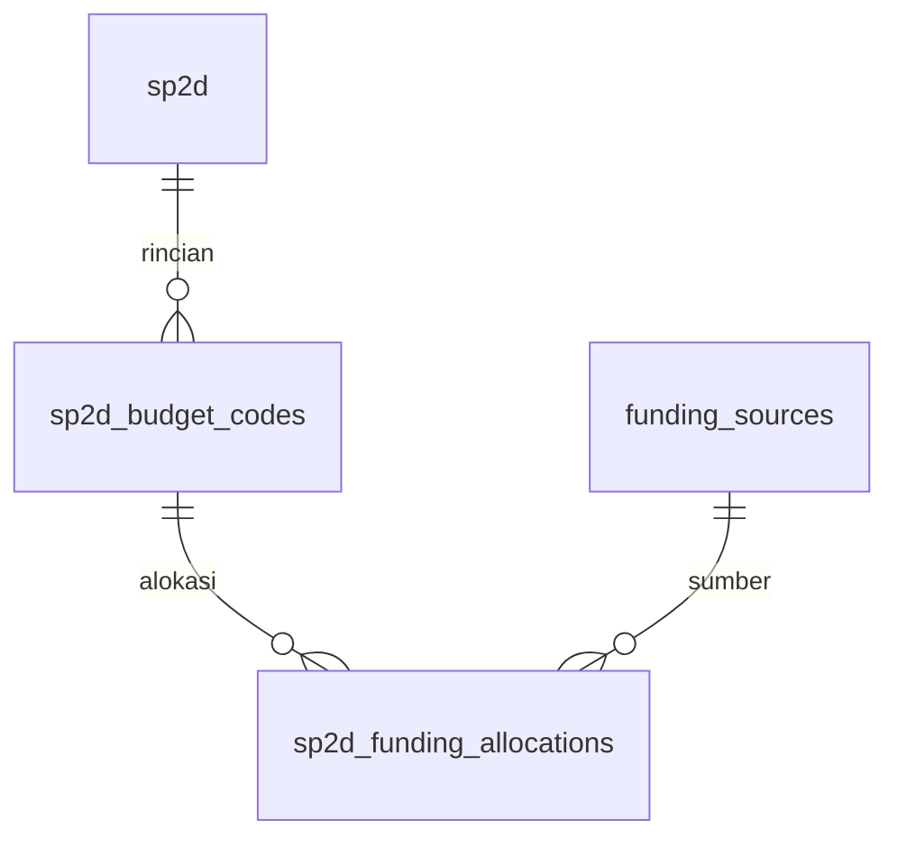

# Sumber dana SP2D

Diterapkan pada database lokal 12 Oktober 2026.

## Cara menggunakan

1. Buka **SP2D → Detail**.
2. Pada rincian belanja, klik **Atur sumber dana**.
3. Tambahkan satu atau beberapa sumber dana dan nominalnya. Nama yang sudah tersedia muncul pada autocomplete; nama baru akan disimpan sebagai master ketika alokasi berhasil disimpan.
4. Total alokasi wajib sama dengan nominal rincian, dihitung hingga dua desimal. Sumber yang sama tidak boleh diulang pada rincian yang sama.
5. Hapus seluruh baris untuk mengembalikan status menjadi **Belum ditentukan**.

Pengguna harus mempunyai izin `manage_sp2d`. SP2D yang selesai direviu harus dibuka kembali melalui alur reviu sebelum sumber dana dapat diubah. Perubahan sumber dana dicatat pada audit log.

## Impor Excel

Template sekarang mempunyai kolom opsional `SUMBER_DANA` di bagian akhir. Isi nama sumber untuk mengalokasikan seluruh nilai baris tersebut ke satu sumber. Kosongkan jika belum diketahui; tidak ada sumber bawaan yang ditetapkan otomatis.

Jika satu rincian memakai beberapa sumber, lakukan pembagian melalui **Atur sumber dana** setelah impor. Jangan menduplikasi baris dengan nominal penuh untuk mewakili beberapa sumber karena akan menggandakan realisasi SP2D. File lama tanpa kolom baru tetap dapat diimpor. Nomor SP2D yang sudah ada tetap dilewati oleh alur impor lama.

## Relasi

`funding_sources.name` unik. Pasangan rincian dan sumber dana unik pada tabel alokasi. Penghapusan sumber yang masih dipakai ditolak oleh foreign key; penghapusan rincian menghapus alokasinya. Nilai tersimpan sebagai DECIMAL(15,2). Validasi jumlah lintas baris dijalankan dalam transaksi aplikasi, bukan CHECK constraint database.

Jika rincian sudah memiliki alokasi, perubahan nominal rincian ditolak agar jumlah alokasi tidak menjadi tidak konsisten. Kosongkan alokasi, ubah nominal melalui alur yang diizinkan, lalu alokasikan kembali.

Belum mencakup pengelolaan kode sumber dana resmi, halaman CRUD master tersendiri, atau filter/grafik laporan berdasarkan sumber dana. Master dibuat dari formulir alokasi atau impor tanpa daftar sumber yang diasumsikan.

## Verifikasi dan deployment

- 75 tes lulus, 1 tes skala besar dilewati, 352 assertions. Build berhasil.
- Migrasi: `2026_10_11_110000_add_funding_sources.php`.
- Backup lokal sebelum migrasi: `5dbb0ee1-cb11-45aa-ae3a-e116b8d3bdcd`, mengikuti retensi backup 24 jam.
- Sebelum/sesudah: 55 OPD, 5 pengguna, 0 SP2D, 0 rincian, 0 SPJ; tidak ada data sumber dana dummy ditambahkan.
- Server produksi lain belum diperbarui. Backup dan verifikasi pemulihan diperlukan sebelum menerapkan migrasi di sana. Rollback menghapus tabel sumber dana dan alokasi baru.
